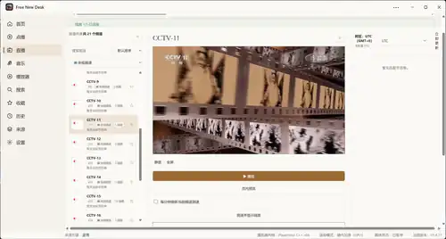
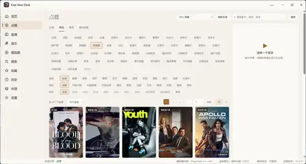
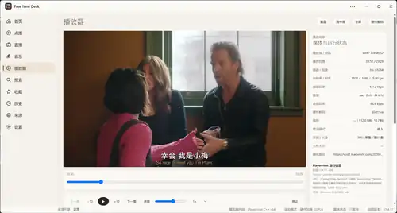
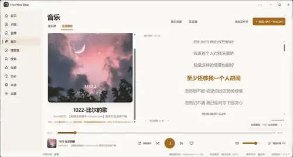

# Free New Desk

> 把 TVBox / FongMi 的「味儿」搬到 Windows 11 桌面 —— 一个**空壳**播放器，所有内容来自你自己配置的来源。

Free New Desk 是一个面向 **Windows 11 x64** 的 TVBox / FongMi 风格桌面影音播放器。软件本身**不内置任何第三方影视源**，只提供用户自有或已获授权配置的导入、解析、直播、节目表与播放能力。本地音乐、NAS、SMB 和 WebDAV 也可以直接加入音乐库。

TVBox/FongMi-style desktop media player for Windows 11 x64. The software does not include any built-in third-party video sources; users import their own sources. Local music files and media from NAS, SMB and WebDAV can also be added to the music library.

**当前版本：V1.5.0** ｜ [下载 Release](https://github.com/cwe88108/free-new-desk-public/releases/tag/v1.5.0) ｜ [全部发行](https://github.com/cwe88108/free-new-desk-public/releases) ｜ [问题反馈](https://github.com/cwe88108/free-new-desk-public/issues)

## 软件介绍

| 能力 | 说明 |
| --- | --- |
| **桌面原生播放** | Electron 界面与 C++ PlayerHost 播放器子进程隔离，使用 libmpv 播放内核，支持硬件解码。 |
| **空壳立场** | 不内置、不推荐任何第三方影视源，所有影视来源由用户自行配置并对合法合规负责。 |
| **兼容 TVBox / FongMi** | 可导入配置 URL 或 sites / lives JSON，兼容 CMS、Type4、JS Spider、Drpy 等来源协议。 |
| **内嵌播放器** | 原生视频窗口嵌入主窗口，提供字幕、音轨、倍速、画面比例、截图、全屏与画中画操作。 |
| **直播与节目表** | 支持 M3U / TXT / JSON、IPTV 多线路、XMLTV / gzip EPG、频道收藏与节目预约。 |
| **音乐与网络音乐库** | 支持本地 / SMB / WebDAV 音乐库、曲目与艺人封面、手动封面、在线同步歌词和播放队列。 |
| **来源管理与审计** | 提供来源分组、批量启停、健康检测、Source Audit 与 JSON 报告导出，便于检查来源兼容性。 |
| **播放器运行时随包提供** | libmpv 已随发行包提供，无需另外安装 VLC / FFmpeg；纯 JVM JAR 来源需要另行准备 Java。 |

## V1.5.0 更新内容

- **首页布局**：迷你播放器移至“我的收藏”下方，与主栏模块保持同宽，常规窗口下统一内容区高度；进度、暂停和音量使用真实播放会话。
- **播放器布局**：播放状态和点播历史／当前队列移至控制条下方，主栏宽度统一；修正暂停状态标签。
- **来源即时刷新**：导入或修改来源后主动刷新关联页面，避免切换页面后才看到导入结果。
- **直播可靠性**：修复播放列表跳转被误判为加载失败的问题，保留播放操作竞争与迟到请求隔离。
- **功能修复**：同步来源操作、收藏原子修改、音乐元数据和相关可靠性修复，保留程序、安装包及快捷方式图标资源。
- **更新检查**：只匿名查询本仓库的 GitHub Release，无需 GitHub 账号或令牌；检查失败不会伪报“已是最新”。

## 主要功能

- **点播**：分类、筛选、分页、搜索、详情、收藏、历史、剧集列表与播放线路。
- **直播**：M3U / TXT / JSON、IPTV 多线路、XMLTV / gzip EPG、频道收藏、最近节目与节目预约。
- **搜索聚合**：多来源并发检索，汇总搜索结果；实际能否播放取决于来源响应及媒体兼容性。
- **播放器**：原生 C++ PlayerHost + LGPL libmpv，支持硬件解码、字幕、音轨、倍速、画面比例、截图、全屏、PiP、播放队列与进度跳转。
- **音乐**：本地 / SMB / WebDAV 音乐库、曲目与艺人封面、手动封面、在线同步歌词、播放队列、进度记忆与 CUE 分段。
- **NAS / SMB**：原生 smb-helper 会话管理，提供共享目录连接、凭据冲突处理和错误提示。
- **来源管理**：TVBox / FongMi 配置导入、来源分组、整组启停、健康检查、Source Audit 与 JSON 审计报告导出。
- **兼容能力**：CMS XML / JSON、Type4、JS Spider、Drpy / Drpy2、XYQ、XBPQ，以及可选 JVM Spider / Plugin Host；不同来源的实际兼容性需要分别检查。
- **设置与诊断**：更新通道、缓存分项清理、日志目录，以及 JVM / Plugin / libmpv 运行诊断。
- **更新检查**：只检查本仓库 GitHub Releases，发现更新后打开发行页面；当前不提供静默下载安装。

## 下载与安装

前往 [V1.5.0 Release](https://github.com/cwe88108/free-new-desk-public/releases/tag/v1.5.0) 下载 Windows x64 版本：

| 文件 | 用途 |
| --- | --- |
| [Windows x64 安装版](https://github.com/cwe88108/free-new-desk-public/releases/download/v1.5.0/Free-New-Desk-Setup-1.5.0-x64.exe) | 正常安装使用，创建桌面与开始菜单快捷方式。 |
| [Windows x64 便携版](https://github.com/cwe88108/free-new-desk-public/releases/download/v1.5.0/Free-New-Desk-Portable-1.5.0-x64.exe) | 无需安装运行；仍会保存应用数据。 |
| [构建对应源码快照](https://github.com/cwe88108/free-new-desk-public/releases/download/v1.5.0/Free-New-Desk-Source-1.5.0-public.zip) | 本次安装包对应的构建源码。 |
| [SHA256 校验值](https://github.com/cwe88108/free-new-desk-public/releases/download/v1.5.0/SHA256SUMS-PUBLIC.txt) | 核对安装版、便携版和源码快照。 |

主要开发与实测环境为 **Windows 11 x64**。Windows 10 x64 的完整兼容性尚未验证。libmpv 已随发行包提供；使用纯 JVM JAR 来源时，请另外准备 Java 17+。

两个 Windows 程序均**未进行发布者代码签名**，不声称具有可信发布者签名。升级前请退出旧程序，并备份本人数据。

## 首次使用

软件首次打开默认没有影视内容。进入「来源」页面后，可以：

1. 粘贴本人自有或已获授权的 TVBox / FongMi 配置 URL 或 JSON。
2. 选择本地配置文件。
3. 导入 M3U / TXT / JSON 直播列表。

导入后可查看来源兼容性明细与健康检查结果，按需启用、停用或删除来源。涉及外部可执行代码的来源，需要先审核代码，再批准当前版本执行。

音乐可直接添加本地文件夹，也可添加 **SMB / WebDAV** 网络音乐库。

应用默认使用用户应用数据目录中的 `free-new-desk-public` 保存配置。迁移数据请使用界面提供的导入功能，不要向公开 Issue 上传个人来源地址、账号凭据、令牌或诊断包。同版本号重新打包不会被更新检查识别为更高版本。

## 界面预览

以下为 **V1.4.17** 打包应用的历史真实截图，展示直播、点播、播放器与音乐模块；不代表 V1.5.0 的新布局或本版验收证据。

<table>
<tr>
<td width="50%"><br/><em>直播：IPTV 频道、多线路、EPG 与播放预览</em></td>
<td width="50%"><br/><em>点播：分类筛选、分页、搜索与详情侧栏</em></td>
</tr>
<tr>
<td width="50%"><br/><em>播放器：PlayerHost / libmpv、硬件解码与播放控制</em></td>
<td width="50%"><br/><em>音乐：本地 / SMB / WebDAV、封面、歌词与播放队列</em></td>
</tr>
</table>

## 安全与使用边界

- JS Spider、JAR Spider 与 Plugin 不进入 Renderer；渲染界面保持 contextIsolation、Sandbox 与 WebSecurity 隔离。
- 外部可执行来源默认不自动获得运行授权，代码或配置变化后应重新审核。
- 只使用本仓库的 GitHub Release 检查软件更新，不使用第三方配置提供的软件更新地址。
- 不内置、不推荐任何第三方影视源；所有影视内容由用户自行配置。
- 安全问题报告方式见 [SECURITY.md](SECURITY.md)。不要在公开 Issue 中提交账号、令牌、个人来源地址或可利用细节。

## 免责声明

- 本软件是空壳播放器，只提供配置导入、解析、直播、节目表和播放能力，**不内置任何第三方影视源**。
- 用户应仅导入本人自有或已获授权的配置与内容，并自行承担所配置内容的合法合规责任。
- 开发者不为第三方来源提供任何内容、推荐、背书或担保。第三方来源的可用性、内容和使用条件由其提供者决定。
- 本软件按**“原样”**提供，不提供任何明示或暗示的担保；第三方来源兼容性和测试通过情况不构成内容或服务保证。

## 已知问题与验证范围

**已知问题：** 播放页向下滚动、视频区域部分离屏时，原生视频窗口可能越过页面顶部；V1.5.0 尚未修复此问题。

V1.5.0 完成 422 项本地单元／集成测试与 21 项原生播放器检查，均通过；构建、类型、脱敏、发行载荷、更新配置与图标资源检查通过。这些检查不代表所有外部来源、显卡和系统环境均已验收。完整跨窗口、硬解／多屏、安装升级及卸载矩阵仍需补齐，本次未重新进行完整人工界面验收。

详见 [V1.5.0 验证范围](docs/PUBLIC-V150-VALIDATION.md) 和 Release 附件 public-verification.json。发行源码快照对应安装包的构建输入，主线另包含后续文档与历史截图更新。

## 开发与构建

需要 Windows x64、Node >=24.18.1、JDK 17、CMake 与 Visual Studio C++ Build Tools。

```powershell
npm ci
npm run verify
npm run package:win
```

构建产物位于 dist/releases。开发说明见 [docs/README-dev.md](docs/README-dev.md)。可用 Release 中的源码快照、SOURCE-FILES.json、release-manifest.json 与 SHA256 校验文件核对构建来源。

V1.4.7 的 **V2 影视仓兼容状态**记录见 [兼容状态文档](docs/compatibility-v2-status.md)，历史数字不作为本版证据。

## 致谢与第三方

Free New Desk 依赖以下生态与开源组件：

- TVBox / FongMi / 猫影视：接口与配置格式生态。
- [Electron](https://www.electronjs.org)：桌面应用框架。
- [libmpv](https://mpv.io)：LGPL 播放内核。
- [Vue](https://vuejs.org) / TypeScript / Vite：界面与开发工具。
- TVBox / FongMi 配置与 Spider 作者。

第三方组件、许可证及 libmpv 构建来源见 [THIRD_PARTY_NOTICES.md](THIRD_PARTY_NOTICES.md)。致谢不表示本项目推荐或担保任何第三方影视源。

## 反馈与许可

- Bug 与功能建议：[Issues](https://github.com/cwe88108/free-new-desk-public/issues)。
- 软件发行：[Releases](https://github.com/cwe88108/free-new-desk-public/releases)。
- 本仓库自身许可证：[LICENSE](LICENSE)。源码公开不等于采用宽松开源许可证；授权范围以 LICENSE 为准，第三方组件按其各自许可证使用。
